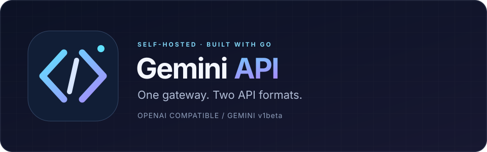

<div align="center">



# Gemini API

### Your tools. Your infrastructure. One Gemini gateway.

Connect OpenAI-compatible applications and Gemini-format clients to a self-hosted Go service—with streaming, tool calling, vision, and configurable image generation.


[Quick start](#quick-start) · [Examples](#examples) · [Configuration](#configuration) · [Deployment](#deployment) · [Troubleshooting](#troubleshooting)

</div>

---

## Overview

**Gemini API bridges Gemini's web interface and familiar developer APIs.** Keep your application's existing request format, point it at your own gateway, and manage the service as a single Go binary or Docker container.

Use it to prototype assistants, connect agent workflows, experiment with multimodal requests, or build a self-hosted integration layer.

> [!IMPORTANT]
> This is an **unofficial gateway**, not Google's official Gemini API or an OpenAI service. It depends on Gemini's web behavior, which can change without notice. Anonymous access, model routing, quotas, and feature availability are not guaranteed. Review the applicable service terms and use only accounts and content you are authorized to access.

## Why Gemini API?

| Capability | What you can build |
| --- | --- |
| **Two API formats** | Use OpenAI-style `/v1` routes or Gemini-style `/v1beta` routes from one server. |
| **Streaming responses** | Deliver incremental output through OpenAI-style SSE or Gemini-style streaming. |
| **Tool calling** | Connect model output to application-defined functions using either request format. |
| **Vision input** | Send image URLs or inline image data alongside text. |
| **Responses endpoint** | Integrate clients that use `/v1/responses`; validate the features your client requires. |
| **Image workflows** | Generate images or provide a reference image through `/v1/images/generations`. |
| **Reasoning selection** | Choose a reasoning level using the project's `@think=N` model suffix. |
| **Self-hosted deployment** | Run a CGO-disabled Go build or the multi-stage Docker image. |
| **Optional gateway authentication** | Require bearer tokens before exposing the service to other clients. |

Anonymous chat is supported by the project without a Google API key or cookie. Signed-in features and image backends have separate requirements; see [Models and routing](#models-and-routing) and [Image generation](#image-generation).

## Quick start

### 1. Get the source

```bash
git clone https://github.com/Rafix4x/gemini-api.git
cd gemini-api
```

### 2. Start the gateway

**Docker** — no local Go installation required:

```bash
docker build -t gemini-api .
docker run --rm -p 127.0.0.1:8080:8080 gemini-api
```

The loopback-only port mapping keeps this quick-start instance off your public network.

**From source** — requires Go **1.26.5 or newer**, as declared in `go.mod`:

```bash
go mod download
CGO_ENABLED=0 go build -ldflags="-s -w" -o gemini-api .
./gemini-api -port 8080
```

> The binary's default port is **8081**. The Docker startup script defaults to **8080**. These examples explicitly use **8080** for consistency. The binary binds to `0.0.0.0` by default; set `host` to `127.0.0.1` in a configuration file for local-only source runs.

### 3. Send your first request

```bash
curl http://localhost:8080/v1/chat/completions \
  -H 'Content-Type: application/json' \
  -d '{
    "model": "gemini-3.6-flash",
    "messages": [
      {"role": "user", "content": "Explain an API gateway in two sentences."}
    ]
  }'
```

Check service status and discover the gateway's model registry:

```bash
curl http://localhost:8080/
curl http://localhost:8080/v1/models
```

A successful status or model-list response confirms that the gateway is reachable—not that an upstream generation request will succeed.

## Examples

### Stream a conversation

Use `curl -N` to display events as they arrive:

```bash
curl -N http://localhost:8080/v1/chat/completions \
  -H 'Content-Type: application/json' \
  -d '{
    "model": "gemini-3.6-flash",
    "stream": true,
    "messages": [
      {"role": "user", "content": "Write a short welcome message for a developer platform."}
    ]
  }'
```

### Connect an OpenAI Python client

Install the client library:

```bash
pip install openai
```

```python
import os
from openai import OpenAI

client = OpenAI(
    base_url="http://localhost:8080/v1",
    api_key=os.getenv("GEMINI_GATEWAY_KEY", "local-development"),
)

response = client.chat.completions.create(
    model="gemini-3.6-flash",
    messages=[{"role": "user", "content": "Give me three ideas for a useful CLI tool."}],
)

print(response.choices[0].message.content)
```

The SDK expects an API-key value even when gateway authentication is disabled. If you configure gateway keys, set `GEMINI_GATEWAY_KEY` to one of those keys. It is **not** a Google API key.

Compatibility is endpoint-specific: OpenAI-shaped requests do not imply support for every OpenAI SDK feature, model parameter, or API product.

### Give the model a tool

```bash
curl http://localhost:8080/v1/chat/completions \
  -H 'Content-Type: application/json' \
  -d '{
    "model": "gemini-3.6-flash",
    "messages": [{"role": "user", "content": "What is the weather in Dhaka?"}],
    "tools": [{
      "type": "function",
      "function": {
        "name": "get_weather",
        "description": "Get the current weather for a city.",
        "parameters": {
          "type": "object",
          "properties": {"city": {"type": "string"}},
          "required": ["city"]
        }
      }
    }],
    "tool_choice": "auto"
  }'
```

Your application must execute any returned tool call and supply the tool result in a follow-up request. Declaring a tool does not give the gateway access to a weather service.

### Send an image

Supply an accessible image URL or a complete `data:image/...;base64,...` value in an OpenAI-style content array:

```json
{
  "model": "gemini-3.6-flash",
  "messages": [{
    "role": "user",
    "content": [
      {"type": "text", "text": "Describe this image."},
      {"type": "image_url", "image_url": {"url": "<IMAGE_URL_OR_DATA_URL>"}}
    ]
  }]
}
```

Replace the placeholder before sending this body to `/v1/chat/completions`. Gemini-format requests can use `inlineData`.

### Use the Gemini request format

```bash
curl http://localhost:8080/v1beta/models/gemini-3.6-flash:generateContent \
  -H 'Content-Type: application/json' \
  -d '{
    "contents": [{"parts": [{"text": "What makes a good developer README?"}]}]
  }'
```

## API reference

| Method | Endpoint | Purpose |
| :---: | --- | --- |
| `GET` | `/` | Service status and build information |
| `GET` | `/v1/models` | OpenAI-style model list |
| `POST` | `/v1/chat/completions` | Chat completion; optional SSE streaming |
| `POST` | `/v1/responses` | Responses-style requests |
| `POST` | `/v1/images/generations` | Image generation and reference-image workflows |
| `GET` | `/v1/images/{id}.png` | Retrieve a generated image |
| `GET` | `/v1beta/models` | Gemini-style model list |
| `POST` | `/v1beta/models/{model}:generateContent` | Gemini-format generation |
| `POST` | `/v1beta/models/{model}:streamGenerateContent` | Gemini-format streaming; documented by this project as NDJSON |

OpenAI-compatible clients should use `http://localhost:8080/v1` as their base URL. Gemini-format integrations use the `/v1beta` route family; client configuration requirements may differ.

## Models and routing

The following are **names in this project's registry**, not a guarantee of distinct upstream models, official Google model IDs, advertised context sizes, or account entitlement.

| Registry name | Project routing / role |
| --- | --- |
| `gemini-3.6-flash` | Default chat selection |
| `gemini-3.5-flash` | Alias using the same mode and reasoning defaults as `gemini-3.6-flash` |
| `gemini-3.7-flash`, `gemini-3.8-flash` | Currently share the same mode and reasoning defaults as `gemini-3.6-flash` |
| `gemini-4-argon` | Separate mode entry in the registry |
| `gemini-3.5-flash-thinking` | Thinking-mode entry |
| `gemini-3.5-flash-thinking-lite` | Adaptive-thinking entry |
| `gemini-3.1-pro` | Pro routing; a signed-in session is required for actual Pro access |
| `gemini-3.1-pro-enhanced` | Experimental Pro entry with extra routing options |
| `gemini-auto` | Automatic-selection entry |
| `gemini-flash-lite` | Lightweight-mode entry |
| `gemini-image` | Image-model entry; behavior also depends on the configured image backend |

Request `/v1/models` for the names exposed by your deployment. See [`internal/models/models.go`](./internal/models/models.go) for the implementation. Unknown model names fall back to the configured default, so a successful response alone does not prove that a requested model name was used.

### Reasoning levels

Append `@think=N` to a registry name:

```text
gemini-3.6-flash@think=0
gemini-3.6-flash@think=4
```

The project documents `0` as deeper reasoning and `4` as faster/minimal reasoning. This is a gateway-specific control—not a standardized OpenAI parameter or a guarantee of upstream behavior.

### Signed-in sessions

The project documents that Pro names may fall back to Flash behavior without a signed-in session. Where authorized, supply a cookie file through `-cookie-file` or the JSON configuration's `cookie_file` field. Session-specific configuration also includes `auth_user` and `xsrf_token`.

Treat cookies as credentials. Never commit them, paste them into issues, or include them in logs you share.

## Configuration

### Configure the binary

Create a `config.json` file. This example is intentionally local-only:

```json
{
  "host": "127.0.0.1",
  "port": 8080,
  "default_model": "gemini-3.6-flash",
  "api_keys": [],
  "retry_attempts": 3,
  "retry_delay_sec": 2,
  "request_timeout_sec": 180,
  "log_requests": true,
  "image_backend": "local"
}
```

```bash
./gemini-api -config ./config.json
```

Before a network-accessible deployment, populate `api_keys` with strong private tokens and set the intended bind address. Clients then send:

```http
Authorization: Bearer <YOUR_GATEWAY_KEY>
```

Configuration-file discovery: explicit `-config`, then `GEMINI_WEB2API_CONFIG`, then `./config.json`, then `~/.config/gemini-web2api/config.json`. Supported command-line overrides include `-port`, `-cookie-file`, `-proxy`, and `-impersonate`.

> [!WARNING]
> The current binary logs a warning and continues with defaults if the selected configuration cannot be read or parsed. Confirm the effective configuration and verify authentication before exposing a deployment.

### Configure Docker

Docker's `start.sh` generates `/app/config.json` from selected environment variables. These are **startup-script settings**; the standalone binary does not automatically read all of them.

| Variable | Docker startup default | Purpose |
| --- | --- | --- |
| `PORT` | `8080` | Listen port |
| `HOST` | `0.0.0.0` | Bind address |
| `API_KEYS` | Empty | Comma-separated gateway bearer tokens; empty disables token requirements |
| `DEFAULT_MODEL` | `gemini-3.6-flash` | Default registry name |
| `COOKIE_FILE` | Unset | Signed-in cookie-file path |
| `IMPERSONATE` | Unset | Optional TLS fingerprint profile |
| `IMAGE_MODEL` | `gemini-image` | Exposed image-model name |
| `IMAGE_MODEL_ID` | `7` | Upstream image-mode identifier |
| `IMAGE_BACKEND` | `local` | Select `local` or Gemini web image routing |
| `LOCAL_IMAGE_URL` | `https://image-gen-ebon.vercel.app` | Default external image-backend URL |
| `LOCAL_IMAGE_PROVIDER` | `alpha` | Local-backend provider selector |
| `LOCAL_IMAGE_MODEL` | `flare` | Local-backend model selector |
| `LOCAL_IMAGE_KEY` | Empty | Backend bearer token |

> **Current startup caveat:** non-empty `COOKIE_FILE` or `IMPERSONATE` values are concatenated incorrectly by `start.sh` and can produce invalid JSON. Until the script is fixed, use an explicit JSON configuration and bypass the startup script for those options.

For an explicit configuration, set `host` to `0.0.0.0` inside the container and mount the file read-only:

```bash
docker run --rm \
  -p 127.0.0.1:8080:8080 \
  -v "$PWD/config.json:/app/custom-config.json:ro" \
  gemini-api /app/gemini-api -config /app/custom-config.json
```

Mount any referenced cookie file separately, read-only, using the container path specified in your configuration.

## Image generation

```bash
curl http://localhost:8080/v1/images/generations \
  -H 'Content-Type: application/json' \
  -d '{
    "model": "gemini-image",
    "prompt": "A minimalist illustration of a mountain observatory at sunrise",
    "n": 1
  }'
```

The project documents URL responses, `response_format: "b64_json"`, and an `image` input for reference-image workflows.

**Choose your backend deliberately:**

- **`local` is the current default.** Despite its name, its default URL is an external service. Image requests are sent to that backend; review its privacy, reliability, and usage terms before sending sensitive material.
- **`gemini` uses Gemini's web image workflow.** The project documents a signed-in session requirement for this mode.
- For a different local-style backend, configure `local_image_url`, `local_image_provider`, `local_image_model`, and, when needed, `local_image_key`. The documented backend response includes `success` and `imageUrl` fields.

Feature availability and output quality depend on the selected backend. Self-hosting this gateway does not make upstream model processing local.

## Deployment

### Docker or a VPS

Build the image, configure authentication, and run it behind a TLS-enabled reverse proxy. Keep proxy buffering disabled for streaming routes and allow suitable timeouts for long-running requests.

For a native deployment, supervise the binary with your process manager and use an explicit configuration file.

### Render

Create a Docker-based web service from this repository. The startup script reads the injected `PORT` variable. Configure private gateway keys, review startup logs, and test both a normal generation request and a streaming request after deployment.

Use `GET /` as a service-status probe. The image's Docker health check polls `/v1/models`; that is not a full upstream generation test. Hosting availability, limits, and pricing depend on the platform.

### Operational checklist

- [ ] Configure and test gateway authentication, including rejection of an invalid token.
- [ ] Enable HTTPS before accepting remote client traffic.
- [ ] Keep configuration files and cookies out of version control.
- [ ] Restrict access to generated images and review their retention requirements.
- [ ] Review which upstream services receive prompts and images.
- [ ] Monitor errors, timeouts, and rate limits; avoid logging sensitive payloads.
- [ ] Confirm streaming works through your actual proxy or hosting platform.

The gateway attempts to refresh Gemini's upstream build identifier at startup. This may help with some upstream changes, but it cannot guarantee compatibility with future web-protocol changes.

## How it works

```text
Your application
    │
    ├── OpenAI-style requests  /v1
    └── Gemini-style requests  /v1beta
    │
    ▼
Gemini API gateway · Go
    │
    ├── Gemini web upstream · chat and supported multimodal workflows
    └── Configured image backend · image-generation workflows
```

The gateway translates client requests into its upstream workflows and converts results back into the requested API format. Authentication at the gateway and authentication to an upstream service are separate concerns.

## Troubleshooting

| Symptom | What to check |
| --- | --- |
| Connection refused | Confirm the listen address, port, container mapping, and process logs. Remember the native default is `8081`, versus Docker's `8080`. |
| Requests work without the intended key | Confirm that the configuration parsed successfully and `api_keys` is not empty. |
| Cookie or TLS-profile settings do not load | Check the `start.sh` caveat above; use an explicit config and bypass the script. |
| Pro output appears to use Flash | Check session validity and account access; model names alone do not guarantee upstream routing. |
| Image generation fails | Check the selected backend, backend connectivity, credentials, and signed-session requirements. |
| Rate limiting or upstream errors | Respect the upstream limit, reduce concurrency, and retry with backoff. |
| Streaming arrives all at once | Check client buffering, reverse-proxy buffering, and hosting timeouts. |
| Upstream changes break generation | Review startup build-refresh logs and repository updates. Refreshing the build identifier may not be sufficient. |
| An SDK feature fails | Verify that its endpoint, request fields, and streaming format match this gateway's implementation. |

When reporting an issue, include the gateway version, deployment method, selected route, and a minimal redacted request. Never include API keys, cookies, or private prompts.

## Development and contributing

```bash
go mod download
go run . -port 8080
go test ./...
CGO_ENABLED=0 go build -ldflags="-s -w" -o gemini-api .
```

Start with [`main.go`](./main.go), [`internal/config`](./internal/config), [`internal/models`](./internal/models), and [`internal/server`](./internal/server).

Contributions are welcome. Keep changes focused, add or update tests for behavior changes, and keep examples aligned with the implemented API. For compatibility fixes, describe the observed upstream behavior without sharing session credentials.

## License and attribution

Released under the [MIT License](./LICENSE). Copyright © 2026 Rafix4x.

Gemini and Google are trademarks of their respective owners. This independent project is not affiliated with, endorsed by, or sponsored by Google or OpenAI. The accompanying gateway logo is original project artwork, not an official Google Gemini logo.

---

<div align="center">

**Build with familiar APIs. Keep control of your gateway.**

If this project helps your workflow, consider starring the repository or contributing an improvement.

</div>
